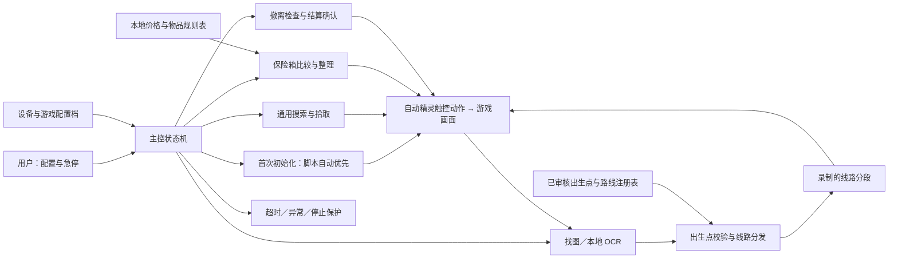
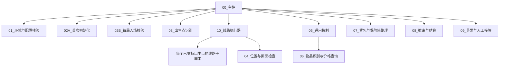
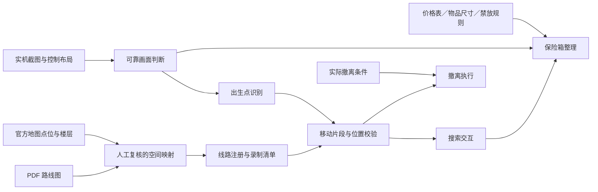
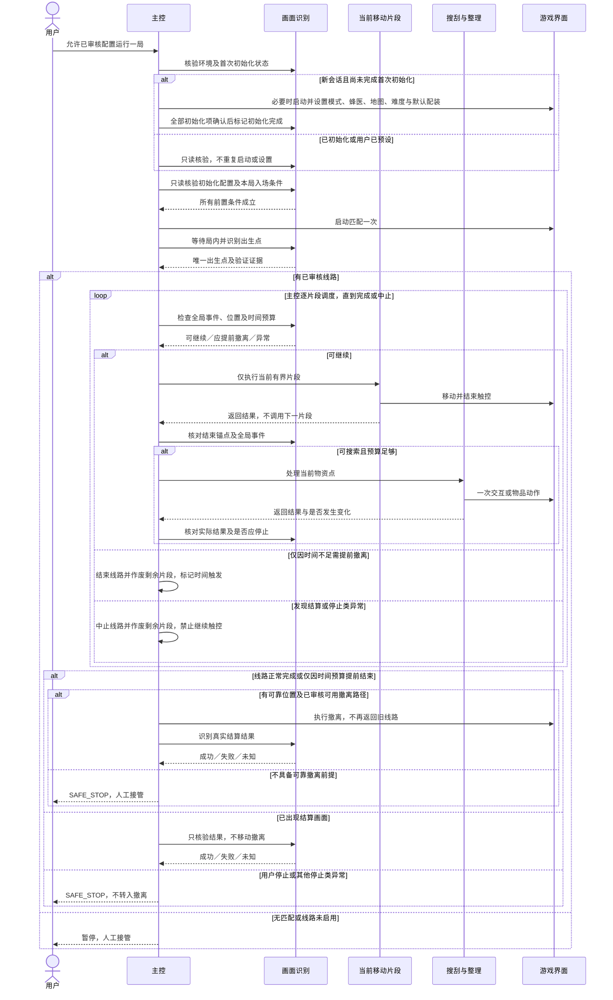
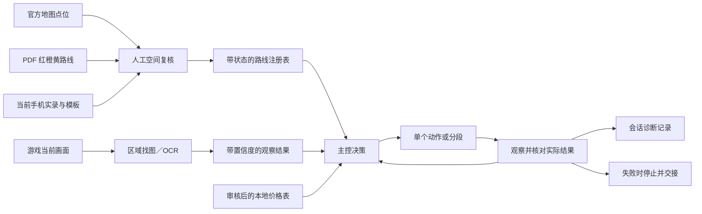

# 三角洲行动自动精灵跑刀：详细设计

日期：2026-10-16（Asia/Shanghai）  
状态：设计草案；需求已确认；待审阅及用户确认，不是可运行脚本。  
实现载体：手机端自动精灵原生动作、条件与线路子脚本。QtScrcpy 仅供查看、配置和录制。

## 1. 目标、依据与非目标

### 1.1 目标

由主控分两层完成：**首次初始化**（启动游戏 → 确认烽火地带 → 选择蜂医 → 选择危险行动／零号大坝／常规行动／默认配装，默认脚本自动执行，可选用户预设）与**每局流程**（只读核验初始化配置与入场条件 → 进入对局 → 识别出生点 → 分发 PDF 对应线路 → 搜索沿途可达物资 → 高价值物资优先入保险箱 → 撤离并确认结算）。同一次游戏会话后续回大厅，不重复启动、选模式、选干员、选地图、选难度或选择默认配装。

### 1.2 来源索引与要求追踪

| 来源编号 | 可核对来源 | 用途与边界 |
|---|---|---|
| U-R01…R10 | /Users/hamgua/Downloads/三角洲跑刀自动化_需求核对_2026-10-16.md，第 2 节 | 用户原八项要求及两次首次初始化补充；2026-10-16 用户回复“可以”确认进入设计，随后补充自动首次初始化优先。 |
| P-ROUTE | /Users/hamgua/Downloads/北七速撤跑刀焚诀.pdf，第 4–5 页 | 东西侧路线及红／橙／黄分支；不能提供手机触摸坐标或动作时长。 |
| Z-STRUCT | /Users/hamgua/Downloads/三角洲免费全自动跑刀双排组队版.zjs | 参考主从文件组织；主控与动作加密，不能据此确认其实际行为。 |
| MAP | https://df.qq.com/cp/a20240729directory/ | 官方地图的出生点、物资点、分层与撤离信息；具体映射仍待记录与复核。 |
| UI-20261016 | /Users/hamgua/Downloads/自动精灵_运行条件核对.png；同日实机菜单检查 | 已看见找图条件、本地 OCR、运行脚本及返回选项、变量和 JS 动作入口；未证明运行时契约。 |
| A-DOC | /Users/hamgua/Downloads/AGENTS.md，第 5、6、11 节 | 文档优先、确认后实现、保留原文件、如实验证。此任务不是社媒系统模块，不套用其 M2／Temporal／租户数据库架构。 |

### 1.3 非目标

- 不解密、不执行、不复制未知行为的第三方加密动作。
- 不读取游戏进程内存，不修改客户端，不设计规避检测机制。
- 不建设独立桌面挂机程序、在线服务或实时外部价格抓取系统。
- 不默认加入双排组队、自动购装、无限循环、自雷、自动丢弃保险箱物品等功能。
- 不承诺每局物资齐全、收益、撤离成功率或账号安全。

## 2. 已核实能力与先行可行性门槛

菜单入口存在不等于能力已验证。正式实现前，必须先使用新建、未加密、无游戏副作用的最小样例完成以下核对；样例本身也须等用户允许实现后再建立。

| 门槛 | 要验证的契约 | 若不满足 |
|---|---|---|
| F1：动作格式 | 本机版本、空白样例的未加密导出／导入、字段及屏幕方向记录 | 不手写猜测 zjs；改为仅在原生编辑器组织动作。 |
| F2：子脚本契约 | 调用是否等待完成、返回主控、额外参数格式、变量可见范围、停止传播 | 不依赖猜测的跨脚本返回值；可以评估“主控内联调度＋独立录制片段”。若连安全调度也无法保证，暂停并重新确认设计。 |
| F3：识别输出 | OCR 输出能否进入变量、找图结果可用形式、区域坐标与横屏一致性 | 不假设剪贴板等于程序可读变量；不能可靠传递时暂停价格／出生点自动决策。 |
| F4：触控执行 | 移动与转向的多指重叠、持续时间、松手、暂停后的残留触摸 | 不录制全路线；先解决控制与急停。 |
| F5：本地状态记录 | 能否持久保存最近阶段／日志；能否在重启后判断状态有效性 | 无持久化能力时仅支持会话内诊断；重启后回到预检，按第 4.0 节重新核验会话，未知局内状态人工复位，不宣传断点续跑。 |

设计中的字段名是逻辑契约，不是已经证实的自动精灵 API。JS 仅考虑用于小规模本地数据比较；在接口未验证前不写虚构函数。

## 3. 结构与职责

### 3.1 架构图

### 3.2 子模块图

上述名称是建议命名，不代表已创建同名文件。主控逐段调度移动、搜刮与整理；线路子脚本一次最多执行当前一个有界片段，然后返回主控，不能在内部连续跑完整条线路。搜刮、整理和异常处理不在每条线路重复录制；只把移动、转向、交互锚点做成路线专属片段。

### 3.3 依赖图

## 4. 主控状态与副作用边界

主控每次仅允许一个状态执行触控；一个子脚本未完成时禁止另一个片段同时控制游戏。首版仅支持一局，不自动开始下一局。

### 4.0 首次初始化与每局流程（用户补充）

**默认策略是脚本自动首次初始化**，一次覆盖启动游戏、烽火地带、蜂医、危险行动、零号大坝、常规行动和默认配装；不要求用户每次手动设置。可选“用户已预设”只用于跳过设置动作，仍须核验这些目标配置后才能通过。

“首次”在本设计中解释为每次新的游戏运行会话，而非安装后的永久一次：

- 游戏尚未启动：脚本发起启动一次，等待可操作画面后确认／选择烽火地带、蜂医、危险行动、零号大坝、常规行动和默认配装；已经是目标设置的项目不重复点击。
- 游戏已打开但本次尚未初始化：不重新启动应用；先检查现状，缺少目标设置才执行首次设置。若正在对局、结算或未知页面，不强制退出以初始化，先暂停交接。
- 只有目标模式、干员、行动类别、地图、难度及默认配装均通过画面复核，才将当前会话标为初始化完成。失败或中断不能提前置位。
- 同一游戏会话后续返回大厅：跳过启动及模式／干员／行动类别／地图／难度／默认配装选择动作，进入每局入场校验；所有初始化项目只读核验。若被用户改动或发生漂移，暂停提示，不把任何首次初始化项目变成每局重复设置。
- 确认游戏重启、出现新启动流程、账号／版本发生变化或初始化证据不再可靠时：先使旧标记失效，重新核验，再决定执行首次初始化。不能永久信任磁盘中的 initialized=true。
- 自动精灵单独重启不必等于游戏重启。若已有画面足以重新确认目标大厅及全部初始化配置，可重新绑定会话并跳过设置；证据不足则暂停，不盲目重复初始化。

逻辑上记录 init_policy（默认 auto_first，可选 user_preset）、init_status、当前游戏会话证据以及最后确认的完整初始化配置。运行时是否有可靠会话标识尚未验证，不要求读取进程内存或使用虚构进程接口；没有可靠标识时依赖画面重核验，无法证明则暂停。

每局入场校验只读核验初始化配置和匹配前置条件，不再次执行任何初始化选择。为核验而打开已知设置页不等于重新选择，但不得点击改选或应用配装。若配装因阵亡等原因不再符合已确认条件，当前设计暂停提示，不自动重套默认配装、补装或采购；这些动作属于需要另行明确的补给策略。首版仍是一局一停；此边界兼容以后经用户另行确认的多局流程，但不默认启用循环。

| 状态 | 进入与成功证据 | 允许动作 | 失败去向 |
|---|---|---|---|
| PRECHECK | 配置档、方向、控制布局、停止方式及所需数据已核验 | 本地读取、画面核对 | SAFE_STOP |
| SESSION_INIT | 新会话需要初始化，或尚未核实；目标模式、蜂医、危险行动、零号大坝、常规行动、默认配装全部核验 | 默认首次自动启动并设置所有初始化项；已设置项跳过；已完成会话只读复核 | 登录、更新、权限、未知页面或同会话配置漂移 → SAFE_STOP |
| PREMATCH_CHECK | 初始化已完成；全部初始化配置和入场条件只读核验一致 | 仅观察／打开已知核验页，不改选模式、干员、地图、难度或配装，不自动补给 | 目标配置或配装不符／组队未确认 → SAFE_STOP |
| READY | 所需配置全部成立，用户已允许实机对局测试 | 进入匹配一次 | 队伍变化、配装费用或未知确认 → SAFE_STOP |
| WAIT_SPAWN | 实际局内 HUD 稳定，不是加载画面 | 只观察，不移动 | 超时、断线、非目标地图 → SAFE_STOP |
| IDENTIFY | 出生点结果唯一、达到校准阈值且二次验证一致 | 打开并关闭地图等已核验非移动动作 | 无匹配、多匹配、未支持出生点 → SAFE_STOP |
| ROUTE | 对应线路为 enabled，初始位置和朝向可核验 | 当前一段移动／交互 | 不符合结束锚点 → RECOVER 或 SAFE_STOP |
| LOOT | 位置锚点及搜索提示成立 | 一次容器交互和受限等待 | 空／已搜 → 下一点；界面未知 → SAFE_STOP |
| ORGANIZE | 物品、格位、价格、限制可可靠判断 | 一次拾取或格位移动并复核 | 未发动作且格位可核验 → 跳过；已发动作但结果不明／部分换位未完成 → SAFE_STOP |
| EXTRACT | 撤离点、可用条件和时间预算成立 | 向已录制可用出口移动及必要交互 | 无可用出口 → 已审核备选或人工接管 |
| VERIFY_RESULT | 看到明确成功结算画面 | 读取结果；不自动准备下一局 | 死亡／失败／超时 → 记录相应结果，不报成功 |
| RECOVER | 已知位置和已审核恢复片段均成立 | 有次数上限的小范围恢复 | 仍不满足锚点 → SAFE_STOP |
| SAFE_STOP | 任意异常或用户停止 | 尽可能停止子脚本并释放触摸，提示人工接管 | 不自行恢复、不反复点击 |

所有重试仅针对可观测、可重复的读取或已知安全动作。匹配、移动、拾取和替换不能用统一自动重试包装。每类超时和重试上限均是待校准配置；未填写时不允许运行，不使用无限等待。

死亡、被击倒、结算失败和断线不视为撤离。重连或自动精灵重启后必须先停止并核对画面，不从上一次动作编号直接继续。

### 4.1 调度仲裁与提前结束

主控是唯一调度者。每个移动片段、容器交互、物品移动的前后，以及可分段等待的每个观察点，都返回主控进行状态仲裁。优先顺序：用户停止／安全验证／失去控制 → 死亡、被击倒、断线或结算画面 → 位置或物品动作结果不明 → 时间预算不足 → 正常搜刮／下一片段。结算画面直接进入结果核验；其余高优先异常停止，不允许普通“成功返回”覆盖它们。

不假设有可并行运行的后台识别线程。两次检查之间可能存在观察盲区；每个子片段及等待的最长持续时间必须有已校准上限。原生急停独立于正常返回边界，其停止传播与触摸释放需通过 F2、F4 才可启用游戏动作；未验证前不得声称可即时中断。

提前撤离流程：主控先确认没有正在执行的触控，结束当前线路任务，作废原线路剩余片段与旧调度标识，再根据最后可靠锚点选择已审核的撤离路径。无法确认锚点或没有当局可用路径则 SAFE_STOP。撤离完成或失败后都不返回旧线路。迟到的子脚本结果只能记录，不能重新激活旧任务；F2 若无法支撑有界串行调度则阻止实现，而非退回不可监控的整线回放。

### 4.2 顺序图

## 5. 出生点与 PDF 路线映射

### 5.1 原则：三份证据交叉，而非按名称猜测

一个出生点只有同时完成以下绑定才能启用：

1. **官方地图位置**：零号大坝／常规／已确定的事件与分层状态下，对应标记、地标和楼层的截图。
2. **PDF 路线起点**：确认红圈、红色箭头方向、分支与终点；不能把感叹号当出生点。
3. **实机起始状态**：地图玩家标记的位置与方向；至少一个可辨认地标；经过多次样本确认的出生视角范围。

用地图上的稳定地标建立两张地图的比例、旋转和裁切对应关系，保存配准截图及误差复核。地图图像坐标、游戏地图 UI 坐标、手机触摸坐标分开保存，不能相互直接替代。楼层、方向与事件状态必须一致；无法可靠配准则保留 unmapped。

先检测可用地图画面与玩家标记，再用场景模板做独立复核。若实机证明某类信息不可可靠获得，需重新审核识别方案，而不是声称原方案已成功。只凭一帧景色或一个相似名称不能分发线路。

### 5.2 PDF 图号

临时图号用于讨论，不是官方出生点编号：

| 临时图号 | PDF 位置 | 内容 |
|---|---|---|
| PDF-E01 | 第 4 页“东侧路线”第一幅 | 东侧第一组常规及分支路线 |
| PDF-E02 | 第 4 页第二幅 | 东侧第二组路线 |
| PDF-E03 | 第 4 页第三幅，末端延续至第 5 页顶部 | 东侧第三组路线；需联合两页核对完整边界 |
| PDF-W01 | 第 5 页“西侧路线”第一幅 | 西侧第一组路线 |
| PDF-W02 | 第 5 页第二幅 | 西侧第二组路线 |
| PDF-W03 | 第 5 页第三幅 | 西侧第三组路线 |

同一幅图可包含多个出生点。图号不能直接充当子脚本调用键；还需登记具体起点和方向。

### 5.3 参考文件的候选出生点清单

这些是解包可读的文件名，不是已确认的官方出生点名。当前全部 **unmapped、disabled**。

| 候选 ID（本地） | 参考子脚本 | 官方位置／实机模板／PDF 图号 |
|---|---|---|
| C01 | 高山上1号.zjs | 待核对 |
| C02 | 西楼一号位1号.zjs | 待核对 |
| C03 | 管道外左下1号.zjs | 待核对 |
| C04 | 管道内1号.zjs | 待核对 |
| C05 | 游客中心外正下1号.zjs | 待核对 |
| C06 | 游客中心外左1号.zjs | 待核对 |
| C07 | 游客中心内右门口1号.zjs | 待核对 |
| C08 | 东楼一号位1号.zjs | 待核对 |
| C09 | 兵营外右下1号.zjs | 待核对 |
| C10 | 变电站外左上1号.zjs | 待核对 |
| C11 | 变电站外正下1号.zjs | 待核对 |
| C12 | 水泥厂内左下1号.zjs | 待核对 |
| C13 | 水泥厂外右下1号.zjs | 待核对 |
| C14 | 水泥厂外左下1号.zjs | 待核对 |

另有东楼、西楼、变电站外正下的组队版条目；不得假设它们是额外出生点，也不自动继承双排模式。辅助文件“自雷”“垃圾处理”“跑完退出”不纳入首版行为。

### 5.4 路线分支与覆盖率

- 红线是基础线路；橙线只在位置、时间、容量和安全条件均已核验时选用。
- PDF 黄色分支依赖危险信息。首版不假设能够识别枪声、脚步或敌人，也不新增麦克风／语音功能。没有明确、经过验证的可观测触发条件时，不自动声称能切换逃生路线；由人工接管或停用该自动化分支。
- “没检测到危险”不等于安全。没有可靠安全判据时默认禁用橙线贪吃分支。
- 首版先启用一个已完整录制和验证的起点；其他起点暂停并交给用户，禁止为了抽到目标点而自动退局或自雷。
- 只有注册表内已审核、enabled 的点计入支持范围；最终逐点扩展到目标地图实际出生点，不能只按参考文件数量声明全覆盖。

## 6. 移动与沿途物资

每条路线由多个短段组成：起始位置／朝向锚点 → 移动及转向动作 → 结束位置锚点 → 物资交互候选。动作时长、摄像机滑动、开门、跳跃等仅从当前控制布局实录，不从 PDF 估算。

物资点登记：所属路线、地图位置及楼层、交互提示模板、容器／地面物资类别、进入与离开锚点、时间预算、是否需要钥匙、被搜或无物资时的处理。

“沿路全吃”的执行含义是：尽量搜索已审核路线走廊中的可达物资点，不为了未录制的远点离开路线。对每个点必须给出结果：已搜索并拾取、空、已被搜索、不可达、容量不足、禁放／不符合规则、识别不确定、时间或危险约束跳过。不能把跳过记成已拾取。

搜索过程：确认提示 → 发起一次交互 → 等待容器打开／搜索状态 → 识别当前已显露物品 → 逐件决定 → 一次动作后复核 → 关闭界面 → 核对角色位置。搜索未完成时不把“尚未显露”当空；搜索超时则按未知处理。

卡住只能在可确认位置执行已审核恢复片段，并受次数和时间预算限制。不能无限向前冲刺或在未知画面持续转向。

## 7. 物资估值与保险箱整理

### 7.1 价格与物品来源

首版采用**用户审核的本地估值表**（设计选择，待用户批准），由可核对的游戏价格画面或用户提供数据录入，包含物品标识、别名、等级、估值口径、价格、更新时间、适用版本、尺寸、堆叠上限和禁放规则。不把地图点位表当价格表，不把未验证的搜索结果当实时交易价格。

必须明确估值口径是出售／参考市场／其他，单次比较不得混用。价格缺失、过期、OCR 歧义或物品无法唯一映射时，禁止自动用其替换保险箱已有物品；可以在已核实的空背包格暂存，也可以跳过。不能仅凭等级为未知物品虚构价格。

### 7.2 优先规则

1. 先过滤无法放入、锁定／需保留、身份未知或价格不可靠的物品。
2. 对可行组合比较估计总价值：数量 × 对应口径的单位价值，并验证二维格位实际可摆放，不只比较总格数。
3. 占格效率用于优先搜索组合，不作为唯一决策；不能把一维背包算法当成二维格位可行性的证明。
4. 同等价值及不确定性下，优先少移动、保留现有布局；等级仅作辅助排序，不能压过明确的价格差。
5. 设定替换收益下限和保守价格误差余量；均需在实施前配置，不填写虚构阈值。收益不足以覆盖不确定性或额外操作时不换。

### 7.3 替换步骤与不可逆边界

- 识别保险箱和背包格位、朝向、数量及锁定物品，建立当前快照。
- 在本地计算目标可行布局与动作顺序；必须有足够临时背包空间供换位，并为每一步留出可核验状态。
- 每次仅执行一个移动，再核对来源、目标和数量；成功后才推进下一步。
- 不把旧物品扔到地面，不自动销毁、出售或消耗物品腾空间。
- 无安全换位空间时保持原状；识别失败或布局与预期不一致时立即停止整理。
- 无法保证原子性或自动回滚。中断可能留下已完成的部分换位；此时显示最后确认状态，人工接管，不盲目反向拖动。

整理返回分三类：**SKIPPED_NO_CHANGE**（没有发出任何移动，且当前格位仍可核验）、**VERIFIED_CHANGE**（目标整理序列已完成，每步和最终布局均确认）、**UNCERTAIN_AFTER_CHANGE**（曾发出移动但结果不明，或换位序列尚未安全完成）。仅前两类可在重新核对画面后返回路线；第三类必须终止线路并 SAFE_STOP，不能当成普通跳过。尤其旧物已移出保险箱、替代物尚未放入时，禁止继续跑线。若连“未发生变化”也不能证明，同样 SAFE_STOP；“保持原状”只描述尚未发出动作时的选择，不描述已发生变化后的恢复保证。

## 8. 撤离、时间预算与失败结果

撤离逻辑独立于“跑完路线”。登记每条已录制线路的主出口、备选出口、启用条件、可观察的可用状态、到达锚点和交互要求。

付费、负重、物品、概率、开关等条件必须按实机与当前地图规则核对；没有核实的出口不得直接导航过去并报告可撤离。首版不自动付费、不丢装备满足条件，不买钥匙。

每次搜索前比较剩余局内时间与“已校准的剩余路程＋交互／撤离等待＋安全余量”。时间读不清时停用贪吃；若当前安全撤离预算也无法确认，则提示人工接管，不假设尚有足够时间。时间不足时停止搜刮，只有存在已审核且当局可用的出口路径才执行撤离。

成功必须识别到成功结算；死亡、失败、黑屏、离开局内或看见大厅都不能单独证明撤离成功。记录成功、死亡／失败、人工停止、状态未知四类结果，首版全部止于单局结果。

## 9. 数据流、逻辑契约和配置有效性

### 9.1 数据流图

### 9.2 逻辑数据项

- **DeviceProfile**：手机横屏尺寸与方向、游戏版本、自动精灵版本、按键布局、灵敏度、模板与录制版本、队伍模式、保险箱／背包网格和保留物品。不能用 QtScrcpy 缩放后的窗口像素代替手机像素。
- **SpawnBinding**：内部 ID、官方标记证据、PDF 图号与起点、实机模板及方向容差、阈值与校准证据、绑定版本、unmapped／recorded／verified／enabled 状态。
- **RoutePlan**：出生点绑定、红线分段、可选分支及可观察条件、物资点列表、出口绑定、恢复片段、校准预算和依赖版本。
- **Observation**：画面类别、对象 ID、区域、识别值、置信度、采集时点；过期观察不能用于拖动物品或继续移动。
- **ItemEstimate**：物品 ID、名称、等级、数量、尺寸、价格口径和版本、估值不确定性、可放入限制、锁定状态。
- **InitializationContext**：init_policy、init_status、当前游戏会话证据、目标模式／干员／行动类别／地图／难度／默认配装及最后画面确认结果；与本局 SessionContext 分离，同一游戏会话复用，重启或证据失效后重核验。
- **SessionContext**：本局逻辑 ID、当前状态、路线与分段、最后可靠锚点、待处理物资、已确认格位、最后动作及结果、停止原因。恢复不能仅凭此数据继续执行。
- **ActionResult**：成功／已处理／跳过／未知／失败，附源状态、结果状态、是否已发出副作用、是否已核验变化、是否部分完成、原因和调度标识；整理采用第 7.3 节三类结果，不能只有一个不区分含义的 true／false。

跨脚本参数／返回值只是目标契约。待 F2、F3 核实后决定落地为原生变量、参数或主控内联；不能依赖未经验证的 JS 全局共享对象。

### 9.3 幂等与版本

交互采用“观察前置状态 → 一个动作 → 复核结果”的受限方式。重新观察容器已打开时不重复开关；物品已移动时不重复拖动；已在匹配中时不再按准备。移动片段不天然幂等，失败后必须定位，不从头重复。

游戏版本、分辨率、键位或灵敏度变化时，对相关模板／片段标记失效并禁止启用；地图事件或楼层变化同样不能沿用旧绑定。价格表变化只影响估值，不自动证明旧格位识别可用。

## 10. 安全、停止、诊断与审计

- 保留自动精灵可达的停止入口。启动前验证其在横屏游戏中不被遮挡，并验证父／子脚本停止传播与触摸释放；不默认 Android 无障碍服务已可用于游戏控制。
- 不自动授权系统权限、不填验证码、不处理账号安全验证；出现此类画面即停止。
- 不使用未知网络服务或上传账号、截图、价格表。截图默认只保存在用户本地；采集游戏素材前避免包含聊天／账号标识等无关信息。
- 本地诊断至少能区分：会话、状态、路线、分段、操作、前后结果、停止原因、配置版本。若自动精灵无法可靠输出日志，用明确状态提示与人工记录替代，并将日志能力标记未完成。
- 无可靠持久化时，不承诺崩溃审计完整性；重启后人工复位。会话内状态不能冒充已写入磁盘的日志。
- 对匹配、移动、拾取、换位、撤离等状态改变记录动作意图与已确认结果；不得将发出动作当成功。

## 11. 验证策略、追踪与边界

本节只是待细化的设计验证策略，不是已完成的测试计划，也没有新增或执行测试。全部事项为 **planned**；后续形成正式测试计划／用例时仍需按 AGENTS.md 完成逐操作追踪和实际结果复核。

| 验证对象 | 主要核验方向 | 来源 | 状态 |
|---|---|---|---|
| 首次初始化 | 全部模式／干员／地图／难度／默认配装首次设置、用户预设跳过、游戏已打开不重复启动、同会话不重复设置、初始化中断不置位、游戏重启失效、脚本单独重启重核验、配置漂移暂停 | U-R02、U-R08、U-R09、U-R10；第 4.0、9、10 节 | planned |
| 每局入场校验 | 全部初始化项只读核验、不重复选择地图／难度／默认配装、配装缺失不自动补给、重复进入不重复匹配、异常停止及结果记录 | U-R02、U-R08、U-R09、U-R10；第 4、9、10 节 | planned |
| 出生点识别与分发 | 每个启用点独立正反样本、相似出生点、多匹配／未知、版本失效、禁止 disabled 分发 | U-R03～R05；P-ROUTE、MAP；第 5 节 | planned |
| 路线移动 | 每个片段的起止锚点、方向偏差、遮挡、卡住、暂停及停止触摸 | U-R07、U-R08；第 4、6、10 节 | planned |
| 物资点交互 | 每个登记点独立检查正常、空、已搜、搜索中、不可达、超时与误识别，不能宽泛地只测“搜刮” | U-R07；MAP；第 6 节 | planned |
| 物品估值 | 价格缺失／过期、同名歧义、等级与价格冲突、数量与价格口径一致性 | U-R06；第 7 节 | planned |
| 保险箱整理 | 不规则空格／可旋转限制、禁放、锁定、无临时空间、一次动作后验证、中断部分换位 | U-R06；第 7 节 | planned |
| 撤离与结算 | 每个出口及条件独立核验、当局不可用、备选、时间不足、死亡／断线不得误报成功 | U-R08；MAP；第 8 节 | planned |
| 子脚本与数据契约 | 导出导入、同步返回、参数与变量作用域、无越界并发控制、停止传播 | Z-STRUCT、UI-20261016；第 2、3、9 节 | planned |
| 可观测与结果记录 | 每条改变状态的路径可区分意图／确认／失败；会话内与持久记录能力分别验证 | A-DOC；第 10 节 | planned |

适用维度包括：成功、输入与画面校验、重复执行、副作用记录、诊断、数据契约和子脚本集成。不能用菜单存在替代任何一项可执行验证。

本地单账号脚本没有 Web API、数据库表、租户或数据库约束，对这些维度记 **not applicable**：原因是本设计不引入相应组件；未来一旦加入远程控制、多账号服务、数据存储或外部接口，即触发重新设计与相应鉴权、隔离、契约和约束验证。该说明不是免除手机权限和账号画面保护。

实机游戏验证属于环境门控：需要正确版本和按键布局、用户确认队伍与配装、可用账号、目标地图、实机录制机会，以及用户明确允许承担对局中的消耗与失败风险。环境未满足时不得把结果标记为已验证。

## 12. 分阶段交付与决策登记

1. **本阶段：详细设计**——本文件，未写动作脚本。
2. **用户确认详细设计后**——细化本地数据契约与采集说明、正式测试计划、样例格式检查方案；本地脚本不建立不必要的 HTTP API 或数据库。
3. **获得实施范围确认后**——先 F1～F5 的无游戏副作用样例，再首次初始化和每局大厅流程；涉及准备／进入对局前再次说明实际影响。
4. **一条线路闭环**——出生点绑定与实录、位置核验、搜索和保守整理、出口与成功结算。其他点仍禁用。
5. **逐出生点扩展**——每个点都有映射、样本、片段、物资与出口记录，以及自己的验证结果。

### 12.1 本设计作出的保守选择（不是对用户未说内容的追认）

- 首次初始化默认脚本自动执行，也允许用户预设；同游戏会话不重复启动、选模式、选干员、选地图、选难度或选择默认配装；游戏重启或证据失效后重新核验（U-R09、U-R10）。
- 首版一局一停；主控逐段仲裁，提前撤离作废原线路；异常、歧义和未支持出生点暂停；不自动自雷、退局重抽或购买物品。
- 未核实危险检测前，禁用自动贪吃／危险触发分支；不伪装成人类听觉判断。
- 使用本地审核估值表，拒绝未知价替换；不自动丢地上的方式腾空间。
- 先一条可验证线路，最终按实际目标出生点逐步覆盖；不把 14 个参考名称当成官方完整清单。

### 12.2 实施前必须采集／由用户确定的项目

| 项目 | 决策边界与未确定时行为 |
|---|---|
| 单排或双排／是否自动补队友 | 需用户明确；不得从参考文件名推断；未确认不开始匹配。 |
| 默认配装的实际内容与可能消耗 | 只接受用户审核的当前配置；不自动购买替代配装。 |
| 保险箱与背包规格、保留物品 | 从当前账号采集并由用户核对；未确认禁用自动换位。 |
| 估值口径与本地表来源 | 用户确认；未提供时只验证识别，不启用价格排序替换。 |
| 首个验证出生点 | 根据实机可采集性选取并记录，不改动路线依据；未抽到支持点则人工接管。 |
| 识别阈值、次数、时间和误差余量 | 依据样本校准，是实施者职责；未校准配置不可启用。 |

当前设计有意将这些输入与运行时门槛显式隔离；可以据此规划采集与实现，但在参数未核验前不能交付“开箱即跑”的脚本。

## 13. 设计审阅记录

2026-10-16 独立实施者审阅指出两处行为分支不够明确，已在本设计修订：

1. 整理尚未动作与已发生部分换位必须区分；后者不确定时停止整局并人工接管，而非跳过后继续跑线（第 4、7.3、9.2 节）。
2. 全局事件由主控在有界片段前后统一仲裁；提前撤离终止旧线路并作废剩余调度，不再从撤离返回搜刮（第 3.2、4.1、4.2 节）。

以上为保守实现选择，随本设计一并交用户确认，不是新增的已验证运行能力。

2026-10-16 用户追加首次初始化要求，已同步至目标、架构／子模块／顺序图、状态机、InitializationContext 和验证策略。此为用户明确偏好：首次由脚本自动执行，用户预设为可选替代；对“首次”的会话边界及失效核验为本设计的具体解释，随设计一并确认。

复核补充：顺序图已明确隔离“正常完成／时间触发撤离”“已结算”“停止类异常”，后两者不得落入移动撤离分支；物品部分换位不确定时始终 SAFE_STOP。

用户再次明确：危险行动／零号大坝／常规行动／默认配装的选择同样只属于首次初始化（U-R10）。已从每局动作中移除配置设置，将其改为 PREMATCH_CHECK 只读入场核验，并同步更新目标、图示、InitializationContext 及验证策略；配装损失不暗中触发自动补给。

2026-10-16 用户确认首次初始化与后续每局执行的划分，包括地图、难度及默认配装只首次选择。本地契约与无游戏副作用能力核验计划已另行整理；该确认不作为创建运行样例、游戏对局或消费的实施许可。
